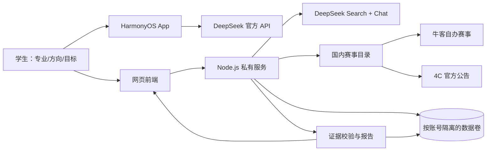
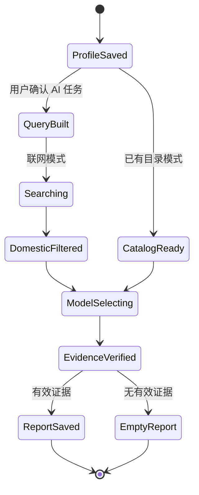
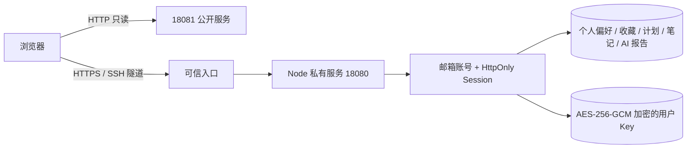

# 比赛雷达架构

## 组件

## Agent 状态流

## 网页账号与部署边界

每个账号通过 `userId` 访问自己的个人数据和 AI 用量；公网只读服务不加载账号数据卷。普通 HTTP 不提供注册、登录或 Key 写入，因为密码和密钥会被明文传输。

## Tool Calling

联网模式首轮必须调用 `search_competitions`，目录模式首轮必须调用 `analyze_catalog`。Node 服务执行工具后，以 `role: tool` 把受限来源重新交给模型；最终结果再经过来源 ID 和逐字证据校验。这样“输入一句目标”可以完成检索、国内过滤、分析和保存，但模型不能直接生成未经来源支持的链接。

## 安全边界

- 公开 `18081` 容器只挂载赛事目录，只读，不挂载个人数据和 DeepSeek Key。
- 私有服务默认只监听服务器 `127.0.0.1:18080`，个人空间使用 HTTPS 或 SSH 隧道。
- HTTPS 反向代理需设置实际 `APP_ORIGIN` 和 `TRUST_PROXY=1`，并禁止公网直接访问 18080。
- 用户 API Key 使用服务器 `DATA_ENCRYPTION_KEY` 加密后落盘，响应只返回是否已配置，不返回 Key。
- AI 报告只接收保存的专业、方向、目标和公开赛事资料，不接收笔记、收藏 ID、计划 ID。
- API 返回的推荐必须引用输入来源 ID，并由本地证据校验后落盘。
